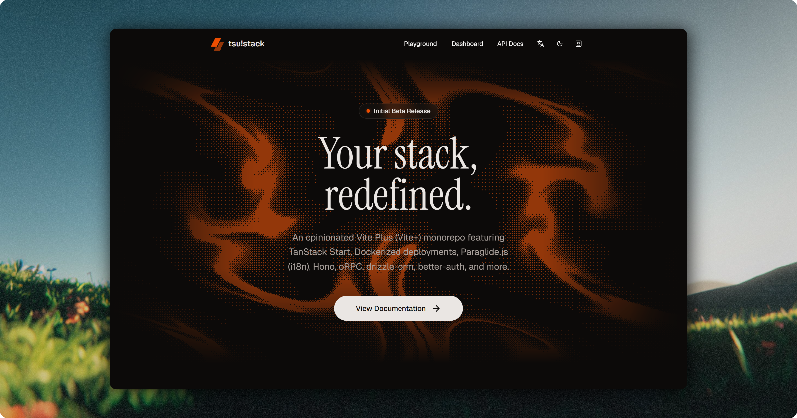
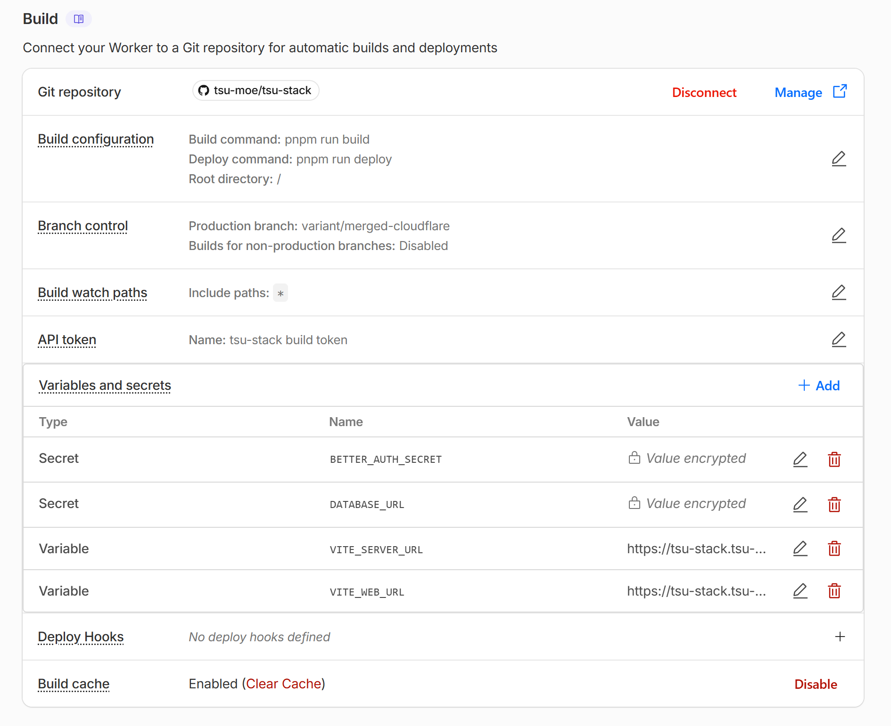
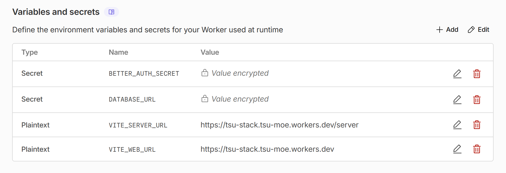

<h1 align="center">
    <br>
    <a href="https://tsu-stack.tsu.moe/">tsu!stack</a>
</h1>

<p align="center">
   
   
   
   
   
   
   
   
</p>

<p align="center">
  Vite Plus (Vite+) TanStack Start monorepo with shadcn/ui, Paraglide.js (i18n), Hono, oRPC, Drizzle ORM, Better Auth, Cloudflare D1, Feature-Sliced Design (FSD), and more. Opinionated and built for the Cloudflare Workers runtime.
</p>

<p align="center">
  
</p>

<p align="center">
  <strong>✨ Live Demo Deployments ✨</strong><br />
  <a href="http://tsu-stack.tsu.moe" target="_blank">Dockerfile (Coolify)</a><br>
  <a href="http://tsu-stack-coolify.tsu.moe" target="_blank">Docker Compose (Coolify)</a><br>
  <a href="http://tsu-stack-merged.tsu.moe" target="_blank">Merged Web + Server with Dockerfile (Coolify)</a> | <a href="https://github.com/tsu-moe/tsu-stack/tree/variant/merged" target="_blank">see branch</a><br>
  <a href="https://tsu-stack.tsu-moe.workers.dev" target="_blank">Merged Web + Server (Cloudflare Workers)</a> | <a href="https://github.com/tsu-moe/tsu-stack/tree/variant/merged-cloudflare" target="_blank">see branch</a>
</p>

## Table of Contents

- [Getting Started](#getting-started)
  - [Prerequisites](#prerequisites)
  - [Setup](#setup)
  - [Keeping Template Changes](#keeping-template-changes)
  - [Database Migrations](#database-migrations)
- [Tech Stack](#tech-stack)
- [Deployment](#deployment)
  - [Coolify](#coolify)
  - [Cloudflare Workers](#cloudflare-workers)
    - [Git-based CI/CD](#git-based-cicd)
  - [Dokploy](#dokploy)
  - [Deploying to Other Platforms](#deploying-to-other-platforms)
- [Environment Variables](#environment-variables)
  - [Server](#server)
  - [Web](#web)
- [Merged Worker Architecture](#merged-worker-architecture)
  - [Resource Usage](#resource-usage)
- [Issue Watchlist](#issue-watchlist)
  - [Pitfalls](#pitfalls)
- [Contributing](#contributing)
- [Acknowledgements](#acknowledgements)
- [License](#license)

## Getting Started

### Prerequisites

- **Node.js** ≥ 26
  - install via [Node.js official website](https://nodejs.org/) or [nvm](https://github.com/nvm-sh/nvm)
- **Vite Plus (vp)**
  - install via `curl -fsSL https://vite.plus | bash` (macOS/Linux) or `irm https://vite.plus/ps1 | iex` (Windows)
- **pnpm** ≥ 12
  - install via `vp install -g pnpm`

### Setup

Use the dedicated [CLI Tool](https://github.com/tsu-moe/tsu-stack/tree/main/tools/create-tsu-stack) and answer the setup wizard questions:

```bash
npm create tsu-stack@next my-app
cd my-app
vp run dev
```

### Keeping Template Changes

Projects created from this template include the `sync-template` agent skill. Ask your coding agent to use `$sync-template` when you want to compare or integrate updates from the matching tsu-stack branch. The generated `.tsu-stack.jsonc` file records the exact source commit used at creation time.

### Database Migrations

```bash
vp run db:migrate:local  # for the local miniflare D1 database
vp run db:migrate:remote # for the remote/prod D1 database
```

## Tech Stack

Here is a non-exhaustive list of the main technologies used in this project, along with their purposes and possible alternatives they replace:

| Technology                                                 | Purpose                                                                                                                                                                       | Replaces/Similar Alternatives                                                      |
| ---------------------------------------------------------- | ----------------------------------------------------------------------------------------------------------------------------------------------------------------------------- | ---------------------------------------------------------------------------------- |
| [**pnpm**](https://pnpm.io/)                               | Fast, disk-efficient package manager for Node.js with package catalogs for monorepo dependecy deduplication.                                                                  | npm, yarn                                                                          |
| [**Vite Plus (Vite+)**](https://viteplus.dev/)             | Unified toolchain for development, testing, and building the monorepo.                                                                                                        | Turborepo, Nx, Vitest, Prettier, ESLint, husky, lint-staged, lefthook, tsdown, tsc |
| [**TanStack Start**](https://tanstack.com/router)          | Modern full-stack React framework with support for SPA, SSR, ISR, and integrated with TanStack Query. It uses Vite's Nitro adapter for cross-platform deployment portability. | Next.js, Remix, React Router                                                       |
| [**Paraglide.js**](https://paraglide.dev/)                 | Compiled internationalization (i18n) library for managing translations.                                                                                                       | i18next, next-intl                                                                 |
| [**Hono**](https://hono.dev/)                              | Lightweight web server framework built on web standards and is WinterCG-compliant for cross-platform portability.                                                             | Express.js, Fastify, Elysia.js                                                     |
| [**oRPC**](https://orpc.dev/)                              | RPC framework to define API routes and generate OpenAPI specs and documentation with [Scalar](https://scalar.com/).                                                           | tRPC                                                                               |
| [**Drizzle ORM**](https://orm.drizzle.team/)               | Type-safe and lightweight ORM for database interactions.                                                                                                                      | Prisma, TypeORM                                                                    |
| [**Cloudflare D1**](https://developers.cloudflare.com/d1/) | Serverless SQLite database bound directly to the Worker.                                                                                                                      | Turso, hosted SQLite                                                               |
| [**Better Auth**](https://better-auth.com/)                | Self-hosted authentication framework with support for all major OAuth providers.                                                                                              | Auth.js                                                                            |
| [**shadcn/ui**](https://ui.shadcn.com/)                    | Accessible and customizable React component library.                                                                                                                          | Chakra UI, Material UI, Mantine UI                                                 |

## Deployment

This template deploys the TanStack Start frontend and Hono API as one Cloudflare Worker backed by D1. The API is mounted at the subpath configured by `VITE_SERVER_URL`, which defaults to `/server`.

### Coolify

This template is not configured for Coolify or Docker. Use the Node merged template when a container deployment is required.

### Cloudflare Workers

The Cloudflare Vite plugin, Worker entrypoint, D1 binding, and Wrangler migration configuration are already included.

You'll need to set the secrets manually in the Cloudflare dashboard before running the deployment commands or via `pnpm wrangler secret put <VARIABLE_NAME>` one-by-one.

Finally, you can deploy by running the following commands:

```bash
pnpm wrangler login # authenticate with your Cloudflare account # copy the shared env variables to the web app's env file for wrangler to read them
vp run deploy       # run the deploy task which uses wrangler to deploy the web app to Cloudflare Workers
```

> [!CAUTION]
> I do not recommend this way of deploying because it is prone to human error.

#### Git-based CI/CD

You can take advantage of Cloudflare's Git-based CI/CD by connecting your GitHub repository to your Cloudflare account and configuring the deployment settings to automatically deploy on pushes to your `main` branch.

You will need to set up the _build environment variables_ and _variables and secrets_ manually in the Cloudflare dashboard in order for builds to succeed.

| **Build Settings**                                  | **Secrets & Variables (Runtime)**                          |
| --------------------------------------------------- | ---------------------------------------------------------- |
|  |  |

> [!CAUTION]
> There isn't an automatic way to do this with my current setup. So you'll need to link the repository first and trigger a failed build, _then_ set the variables and trigger another deployment for the changes to take effect.

> [!TIP]
> D1 is provided through the `DB` binding. Do not configure `DATABASE_URL`; provision the database and apply its Wrangler migrations instead.

### Dokploy

[Dokploy](https://dokploy.com) is not a deployment target for this Worker template. Use the Node merged template for Dokploy.

### Deploying to Other Platforms

This template is coupled to the Cloudflare Vite plugin, Workers runtime, and D1. Moving it to another platform requires adapting database access, bindings, the build adapter, and verified client-IP handling together.

> [!CAUTION]
> Changing only the Vite adapter is not sufficient. Runtime bindings and database behavior are part of the deployment contract.

## Environment Variables

### Server

For the Hono server, use the following environment variables:

| Variable Name          | Required | Default Value | Description                                                                                      |
| ---------------------- | -------- | ------------- | ------------------------------------------------------------------------------------------------ |
| `VITE_SERVER_URL`      | ✅       | -             | Base URL for the server. May also include a subpath if needed, ex: `https://example.com/server`. |
| `VITE_WEB_URL`         | ✅       | -             | Base URL for the web app. May also include a subpath if needed, ex: `https://example.com/web`.   |
| `BETTER_AUTH_SECRET`   | ✅       | -             | Secret key for Better-Auth. Generate with `vp run auth:secret`.                                  |
| `ENABLE_OPEN_API_DOCS` | ❌       | `false`       | Enable OpenAPI `/docs` endpoint.                                                                 |

### Web

For the web app, use the following environment variables:

| Variable Name             | Required | Default Value | Description                                                                                                                         |
| ------------------------- | -------- | ------------- | ----------------------------------------------------------------------------------------------------------------------------------- |
| `VITE_SERVER_URL`         | ✅       | -             | Base URL for the server. May also include a subpath if needed, ex: `https://example.com/server`.                                    |
| `VITE_WEB_URL`            | ✅       | -             | Base URL for the web app. May also include a subpath if needed, ex: `https://example.com/web`.                                      |
| `BETTER_AUTH_SECRET`      | ✅       | -             | Secret key for Better-Auth. Generate with `vp run auth:secret`.                                                                     |
| `VITE_IMGPROXY_URL`       | ❌       | -             | URL for image optimization. You'll need to deploy your own [imgproxy](https://hub.docker.com/r/darthsim/imgproxy/) container first. |
| `VITE_IMGPROXY_SIGNATURE` | ❌       | `_`           | imgproxy signature path segment. Use `insecure` or a precomputed signature if your imgproxy setup requires it.                      |

## Merged Worker Architecture

`apps/web/src/routes/server/$.ts` forwards the API subpath to the Hono app exported by `apps/server`. Cloudflare owns the network listener, so `apps/server` is an internal package rather than a separately deployed service.

Keep `VITE_SERVER_URL` on the same public origin as `VITE_WEB_URL` and include the API subpath, for example `https://example.com/server`. Configure required values as both Cloudflare build variables and Worker runtime secrets where applicable. Provision the D1 database and replace the placeholder binding ID before deployment.

### Resource Usage

Web rendering and API traffic share one Worker deployment and its limits. Better Auth rate limits use D1 for shared enforcement, while log-ingestion and readiness limits are intentionally lightweight and isolate-local. Add a Cloudflare edge rule when those operational endpoints need a global abuse boundary.

## Issue Watchlist

Last verified on November 10, 2026.

- [TanStack Router #7529](https://github.com/TanStack/router/issues/7529) - Keep the Router/Start dependency set pinned because newer `router-core` releases can leave the SSR query stream open until the serialization timeout.
- [TanStack Router #6275](https://github.com/TanStack/router/issues/6275) - Keep the Vite preview host on `127.0.0.1` so prerender builds can reach the preview server.
- [TanStack Router #8550](https://github.com/TanStack/router/issues/8550) - A CSP nonce delivered in a response header can make hydration duplicate inline module scripts because the browser hides the nonce from `getAttribute()`.
- [TanStack Router #8789](https://github.com/TanStack/router/issues/8789) - Hydration scripts can miss a CSP nonce when it is assigned after the router's SSR state is created.

### Pitfalls

- Prefer exposing the web app and API on one public origin, such as `https://example.com` and `https://example.com/server`. Host-only auth cookies then reach authenticated SSR without being shared with sibling subdomains. Different-site auth can also fail in Safari because WebKit's [Intelligent Tracking Prevention (ITP)](https://webkit.org/tracking-prevention/) applies Full Third-Party Cookie Blocking. If separate public origins are unavoidable, test authenticated SSR and OAuth in Safari and configure Better Auth cookies, trusted origins, CORS, and proxy routing deliberately; sibling subdomains are same-site for ITP but still do not share host-only cookies.
- The template does not enforce CSP because the TanStack nonce issues in the watchlist can break hydration. Treat all user-authored HTML as untrusted and sanitize it before rendering. Revisit a strict nonce- or hash-based CSP before adding high-risk script integrations; do not silence CSP errors with `unsafe-inline` as a permanent fix.
- If you change the API's `/server` path or put web and API on different origins, update `VITE_SERVER_URL`, proxy routing, CORS origins, and `OPTIONS` forwarding to match.
- Per-client rate limits rely on Cloudflare's `CF-Connecting-IP` header. If you add a non-Cloudflare ingress or Worker-to-Worker subrequest path, establish and test an equally trustworthy client-address boundary before relying on those limits.
- If you deploy to production, replace the example `BETTER_AUTH_SECRET` with a generated secret shared by the web app and API. If you publish Cloudflare build artifacts outside Wrangler, exclude `dist/<worker>/.dev.vars`, which can contain build secrets.
- If the web app runs under a subpath such as `/web` and you want search engines to discover `robots.txt`, expose it at the [domain root](https://developers.google.com/search/docs/crawling-indexing/robots/intro) through a redirect or root route. For multiple subpath apps, add a root sitemap index and point `__root.tsx` at it if you want the app to advertise that index.

## Contributing

Pull requests are welcome. For major changes, please open an issue first to discuss what you would like to change. If there are any bugs, please open an issue.

To get started, fork the repo, make your changes, add, commit, and push your changes to your fork. Then, open a pull request. If you're new to GitHub, [this tutorial](https://www.freecodecamp.org/news/how-to-make-your-first-pull-request-on-github-3) might help.

You can support the project by giving it a star, sharing it with your friends, contributing to the project, and reporting any bugs you find.

## Acknowledgements

This repository builds on [mugnavo/cove-monorepo](https://github.com/mugnavo/cove-monorepo).

## License

This project is licensed under the MIT License - see the [LICENSE](../LICENSE) file for details.
